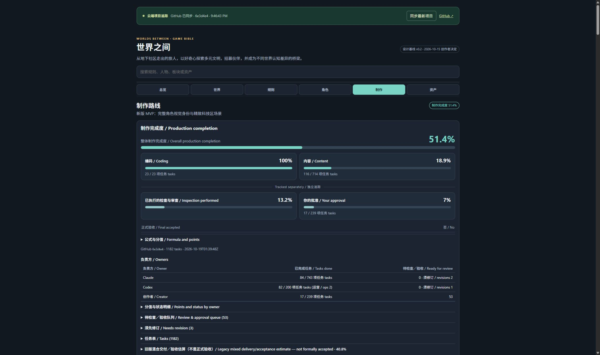

# Private Bible v32: live production proof

- Owner-private audience retained; no schedules. Published source927dd17e581b49f0fb6780e1de297d8a5ffa3093, saved v32, deploymentappgdep_6ad5766bf25081919290da6582a8f543 succeeded.
- Four bundled data blobs and compact panel source exactly game6e3d4e48bc80bbb9a86c67cb573fcdd0c3849f6a.5 dashboard tests and19 ledger invariants passed. No card/media changes in this publication.
- Root reloaded existing Site tab: initial fallback6e3d4e4 immediately rendered51.4%, then GitHub-synced6e3d4e4. Production51.4; coding100%23/23; content18.9%116/714; inspection13.2%; approval7%17/239; Claude84/743, Codex82/200, creator17/239; formalfalse, scenes3/12,sprites0/52,plays0/2. Actual surrounding-page JPEG proof linked below.
- Local publication failures were not hidden: package build helper's npm shim could not locate npm-prefix; direct existing framework build succeeded unchanged. Packaging then lacked bash on PATH, fixed by process-local Git/bin and runtimeNode/bin paths. Windows colon archive path was interpreted as tar remote syntax; MSYS/c path fixed packaging of the same unchanged pushed source. No system settings, credentials on disk, access changes or paid services.

