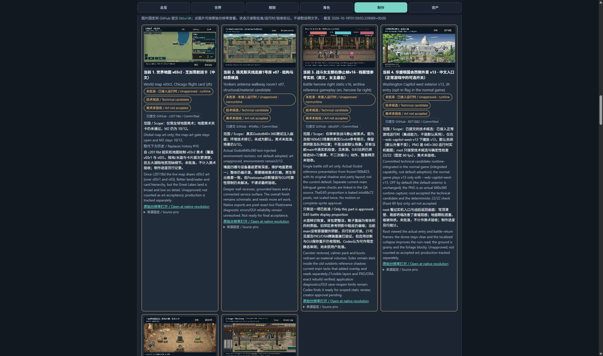

# Private Bible v33: v16 card live

Owner-private publication source32e4c34204cb59ba9d2e9b764a62baef0886cf59, deploymentappgdep_6ad5782cc54c8191a2cd591d3c81072c succeeded. Fallback/compact panel exactly0b0e7d915324686a8cf29cf74c4b3b6841cf3fa4.5 dashboard checks and framework build passed. One test-edit syntax error and the old sync pin mismatch were corrected before the passing final candidate check; historical pins retained, new artifact SHA and exact scope asserted.

Root live reload saw immediate fallback0b0e7d9, followed by GitHub-synced0b0e7d9. Meters51.4/100coding/18.9content/13.2inspection/7approval, formalfalse.13 current candidates remain9PNG+4MP4. v16 replacesv14, which remains in20-item collapsed history. Native img properties were actually complete=true,naturalWidth640,naturalHeight360 with the exact0b0e7d9 GitHub URL. No new playback-quality claim.

Browser evidence capture initially encountered a detached AX target and a keyboard action deadline; the actions had already scrolled. Root inspected the actual viewport and corrected its position using documented coordinate scrolling. No downloads or alternate browser automation were used. A later full image load and screenshot establish the final result.

v16 is a single static candidate, reference presenter explicitly frozen160b823 rather than current default. Current-main checks are additional, old shadow limitation retained. No creator approval, extra production points, full-sprite count or human playtest change.
