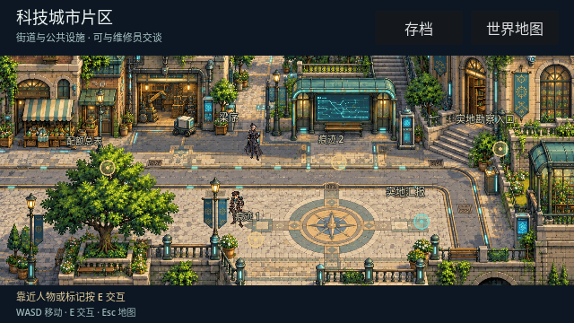
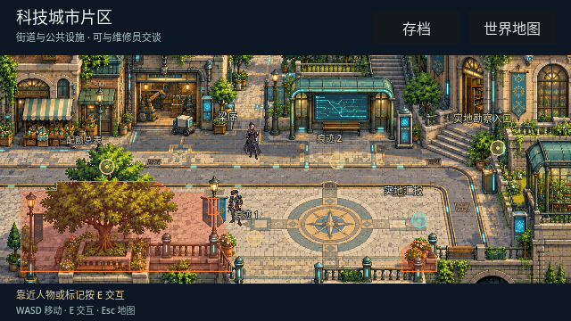
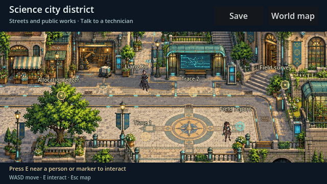
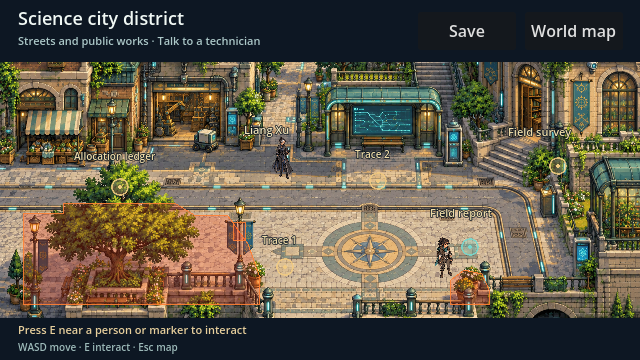

# City navigation candidate — M8

Replaces the broad western exclusion rectangle with traced foot-position polygons around the garden, lamp base and southeast planter. This reopens the west paving and follows the garden corner more closely. Geometry includes provisional clearance; it is not final scene art.

Movement sweeps in steps of at most two logical pixels and slides on contact, preventing a long frame from crossing an obstacle. Loading a now-invalid save projects the actor onto the nearest valid polygon edge; valid positions remain exact and repeated recovery is stable. The old `(82, 260)` city spawn now recovers to `(82, 203.5)`.

## Validation

- Godot 4.7.2: city navigation passes headless and rendered OpenGL. Tests flood the walkable area to verify approach to all six hotspots, check garden/lamp/planter solidity, a long-frame crossing, diagonal sliding, and a grid of valid/invalid saved positions.
- City integration passes for both protagonist appearances, foot anchoring, hotspot movement, recruitment visibility, valid/legacy saves and map return.
- M2, M6 and both M7 automated route checks pass. Test receipts stay in isolated test storage; no human completion receipt was created.
- Four separate actual engine viewport captures were visually inspected: Chinese male and English female beside the solid bases, with normal views and diagnostic boundary overlays. The overlays exist only in the test, not the playable UI.
- M6 and integration still emit existing ObjectDB leak warnings on exit. Rendered execution used dummy audio and cannot assess sound.

## Evidence

Manifest: [rpg-2-star-ocean-the-second_scifi-city_navigation-manifest_m8-boundaries_20261014-063728-a19da10f.json](rpg-2-star-ocean-the-second_scifi-city_navigation-manifest_m8-boundaries_20261014-063728-a19da10f.json)

## Remaining gates

The background is still a flat candidate image and characters are static cutouts. Building/stair alignment, foreground occlusion, directional animation, window/fullscreen review and two genuine human timed playthroughs remain. No art acceptance flags or milestone statuses changed.
